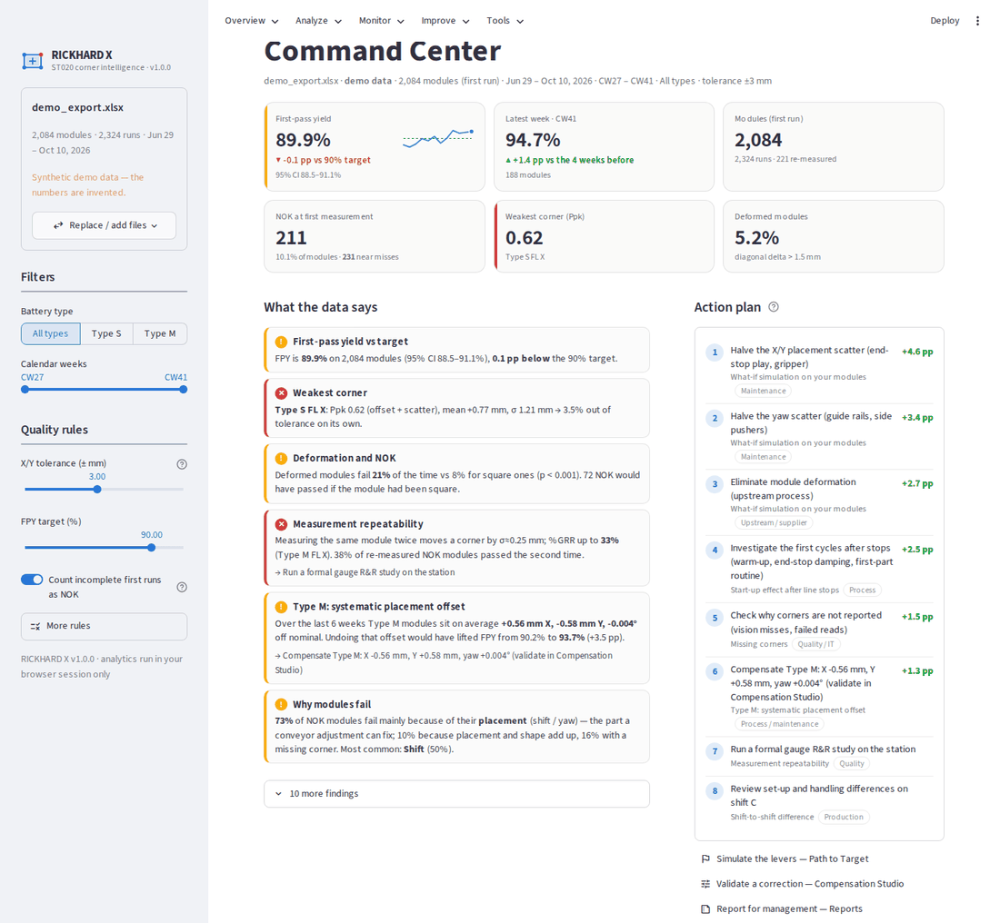
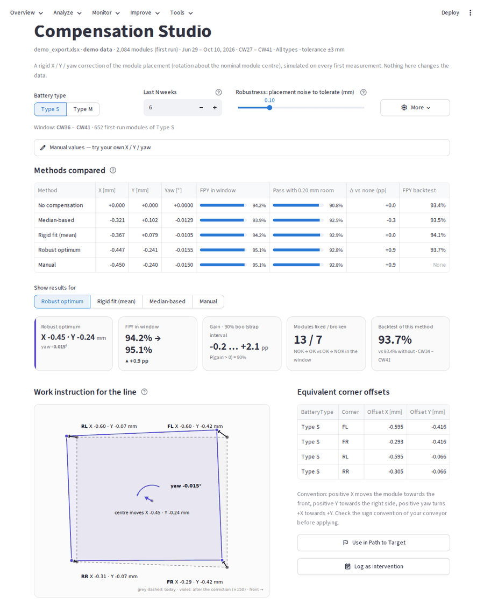
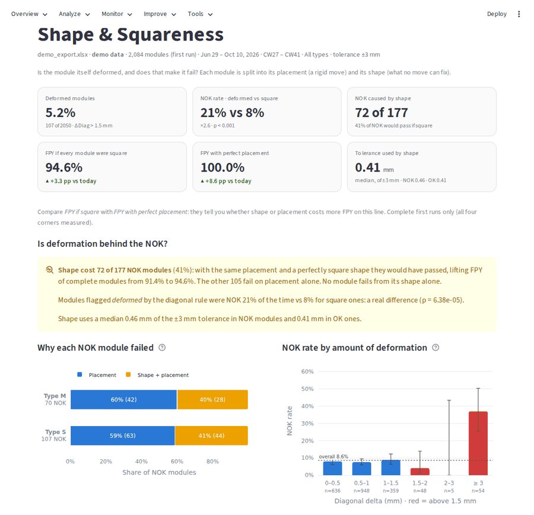
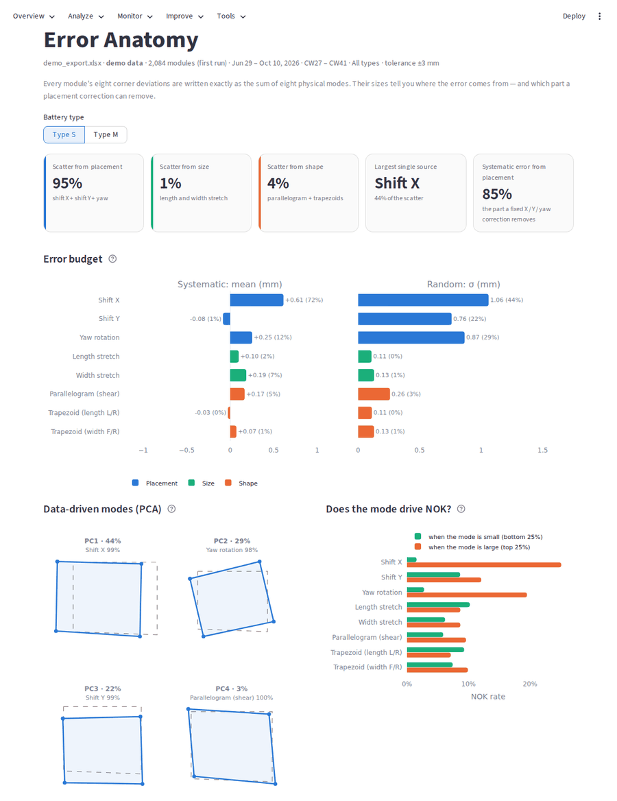
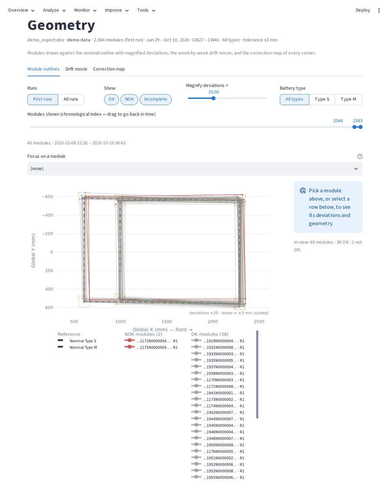
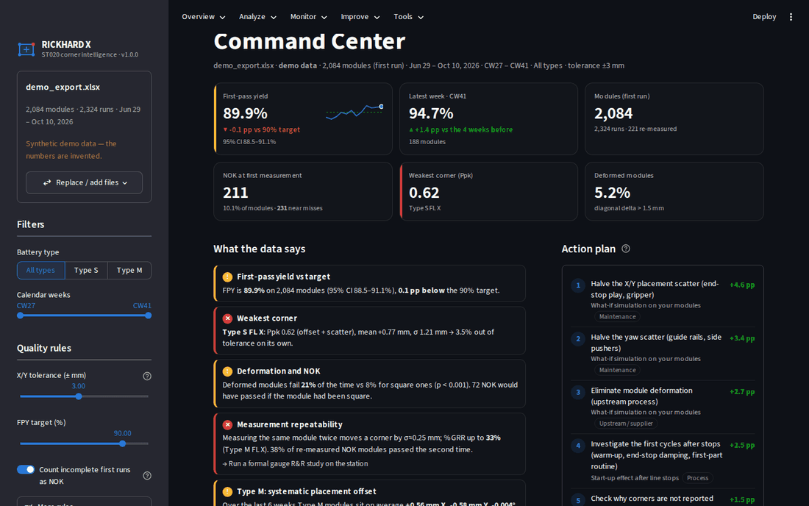

# RICKHARD X · ST020 corner intelligence

A Streamlit dashboard for the first-measurement quality of battery modules at station ST020. Load the
*Corner Cell Deviations* export and it answers the questions the line actually asks:

- **How good are we?** First-pass yield (FPY) per week against the target, with 95 % confidence intervals.
- **Why do modules fail?** Every NOK first run gets a failure mechanism: shift, yaw, shape (the module itself is not
  square), height or a missing corner.
- **Where does the error come from?** Each module's eight corner deviations are split exactly into eight physical
  modes (shift X/Y, yaw, length/width stretch, parallelogram, two trapezoids), so you see which part a conveyor
  adjustment can remove and which part it never will.
- **Did something change?** SPC with run rules, process shifts dated automatically, and an alarm board that compares
  the last days with a baseline.
- **What should we adjust, and is it safe?** X / Y / yaw compensation (the original median method, a rigid fit and a
  robust optimum), back-tested week by week, with a readiness check and a work instruction for the line.
- **What would it take to reach the target?** What-if levers simulated on your own modules.

It builds on [RICKHARDV](https://github.com/rvegavillalobos-beep/RICKHARDV) and on its rebuild *Corner QC*
([New](https://github.com/rvegavillalobos-beep/New)): everything both computed is still here — corner targets, trend
matrix, centroid drift and yaw, the squareness report and its link to NOK (would the module have passed if it were
square?), median-based and optimised compensation with a backtest — with the same formulas and the same numbers
(checked by the test suite against the original code). The Excel export keeps the original sheet names
(`Module_Summary_Report`, `First_Run_Quality_Summary`, `Weekly_FPY_Trend`, …), so anything built on it keeps working.



<table>
  <tr>
    <td width="50%"></td>
    <td width="50%"></td>
  </tr>
  <tr>
    <td><b>Compensation Studio</b> — median, rigid-fit, robust and your own X / Y / yaw side by side, with a
      backtest and a work instruction for the line.</td>
    <td><b>Shape &amp; Squareness</b> — would each NOK have passed if the module were square, or placed
      perfectly?</td>
  </tr>
  <tr>
    <td></td>
    <td></td>
  </tr>
  <tr>
    <td><b>Error Anatomy</b> — the eight physical modes behind every deviation: systematic vs random, and
      which ones drive NOK.</td>
    <td><b>Geometry</b> — every module drawn against its nominal outline, magnified; click a module to
      focus on it.</td>
  </tr>
</table>

<details>
<summary>Dark theme</summary>



</details>

*Screenshots show the built-in demo data (synthetic numbers).*

## Run it

**Streamlit Community Cloud:** *Create app* → repository `rvegavillalobos-beep/AI`, branch `main`, main file
`streamlit_app.py`.

**Locally** (Python 3.11+):

```bash
pip install -r requirements.txt
streamlit run streamlit_app.py
```

No data at hand? Press **Explore with demo data** on the start page: a synthetic export in the same format with a
realistic process story (an end-stop adjustment, guide wear and a realignment, a night-shift offset, deformed
modules, re-measurements). The numbers are invented. Adding `?demo` to the app's address opens it directly on the
demo data.

## The data

The app reads the station export as it comes (`.xlsx`, `.xlsm`, `.xls`, `.csv`, `.txt`):

- two title rows, then the columns *Time*, *Part ID*, *Featurename* and the X / Y (and optionally Z) deviations; the
  header row, the delimiter (`,` `;` tab) and the decimal comma are detected automatically;
- the feature name tells the corner (FL, FR, RL, RR); the Part ID and feature name tell the battery type (Type S,
  Type M);
- several files can be loaded at once — overlapping periods are de-duplicated;
- a module measured again becomes run 2, 3, …; only the first run counts for FPY.

*Data & Settings* shows exactly what was read: a data-quality report, how times, runs and corners were interpreted,
the nominal geometry, the shift plan, and manual overrides if the automatic detection guesses wrong. Files stay in the
browser session; nothing is stored on a server. Rules, reading options and the intervention log can be saved as a
small project file and loaded again later.

## Pages

| Section | Page | What it answers |
|---|---|---|
| Overview | **Command Center** | FPY vs target, what the data says in plain language, a ranked action plan with the FPY each action is worth, why and where modules fail. |
| Analyze | **Corner Lab** | Corner targets, capability per corner and axis (Cp, Cpk, Pp, Ppk with confidence intervals and ppm), offset vs scatter, the original trend matrix. |
| | **Geometry** | Modules drawn against the nominal outline with magnified deviations (scroll back in time; each module is a legend entry to hide or isolate), a focused module's corner values and geometry, the week-by-week drift movie, the correction map. |
| | **Shape & Squareness** | Is deformation behind the NOK? Why each NOK failed (placement / shape + placement / shape), the tolerance the shape uses up, NOK rate by amount of deformation, the original squareness report and root-cause rules. |
| | **Drift & Yaw** | The original centroid path, weekly median offset and yaw, yaw of every module, plus the least-squares placement over time with automatically dated process shifts. |
| | **Error Anatomy** | The eight-mode decomposition: error budget (systematic vs random), data-driven modes (PCA), which modes drive NOK, weekly mode trends. |
| Monitor | **SPC Monitor** | Alarm board (recent window vs baseline), I-MR and weekly X̄ charts with Nelson rules. |
| | **Time Patterns** | Shifts, weekday × hour, and the first modules after the line stood still. |
| | **Re-measurement & MSA** | %GRR per corner coordinate estimated from production re-measurements; how often a NOK turns OK on the next run. |
| | **Height (Z)** | Level, pitch, roll and twist of every module (shown when the export contains Z). |
| Improve | **Path to Target** | What-if levers: how much offset and scatter must go to reach the FPY target, with a sensitivity chart. |
| | **Compensation Studio** | Median, rigid-fit, robust and your own X / Y / yaw compared in-window, with a safety margin and out-of-sample (backtest), FPY maps over X / Y and yaw, readiness checklist, work instruction, piece-level simulation. |
| | **Interventions** | Log what was done to the line and get a before / after verdict with statistics. |
| Tools | **Module Passport** | Everything about one module: runs, geometry, why it failed, what was produced around it. |
| | **Data & Settings** | Data-quality report, reading options, nominal geometry, shift plan, project file. |
| | **Reports** | A formatted Excel workbook for the team and a management report (HTML) that opens in any browser. |

The sidebar holds the filters (calendar weeks, battery type) and the quality rules (tolerance, FPY target,
squareness limit, whether incomplete modules count as NOK, whether Z decides PASS/FAIL).

## Fixed from the original

- An export containing the skipped spring daylight-saving hour in Germany stopped the app with an error, and rows in
  the repeated autumn hour were lost. Now both are converted and counted in the data-quality report.
- The time format was guessed from the first row: with an "am" time on top, every "pm" row was silently dropped.
- Calendar weeks had no year, so CW01 sorted before CW52 at the turn of the year (now `2026-CW53`, `2027-CW01`).
- An exact duplicate row created a fake, incomplete re-measurement; overlapping exports doubled modules.
- All-zero failed reads were used as perfect corners.
- Everything was recomputed row by row on every click; reading and analysis are now vectorised and cached.

## How the numbers are made

The methods are described in [docs/methodology.md](docs/methodology.md). In short: FPY uses the first run of each
module with Wilson intervals; group differences use Fisher's exact test, Welch's t-test and Brown–Forsythe;
capability uses the moving-range σ for Cp/Cpk and the overall σ for Pp/Ppk; the error anatomy is an exact
orthonormal decomposition of the eight deviations; the robust compensation maximises the expected FPY under the
observed placement noise and is validated walk-forward.

## Project layout

```
streamlit_app.py      entry point: page config, sidebar, navigation
app/                  Streamlit layer (pages, sidebar, cached data access, UI helpers)
rickhard/             analytics package — no Streamlit imports, every number testable
  loading.py          export reader (headers, CSV dialects, time zones, runs, de-duplication)
  analysis.py         the pipeline: runs → first runs → status, FPY, squareness, anatomy
  geometry.py         rigid fit and the eight-mode error decomposition
  compensation.py     median / rigid / robust compensation, backtest, readiness
  spc.py, patterns.py, remeasure.py, zheight.py, events.py, improvement.py, insights.py
  report.py, report_html.py   Excel and HTML reports
  charts/             Plotly figures (colour-blind-safe palette, light and dark)
tests/                pytest suite, the original app's logic for parity checks, page smoke test
```

## Tests

```bash
pip install -r requirements-dev.txt
pytest
```

The suite checks loading edge cases, parity with the original RICKHARDV formulas, the geometry and compensation
maths, SPC, insights and both reports, and renders every page in many scenarios. CI runs it on every push. To also
compare a real export with the original logic:

```bash
RICKHARD_REAL_FILE=/path/to/export.xlsx pytest tests/test_parity.py
```
